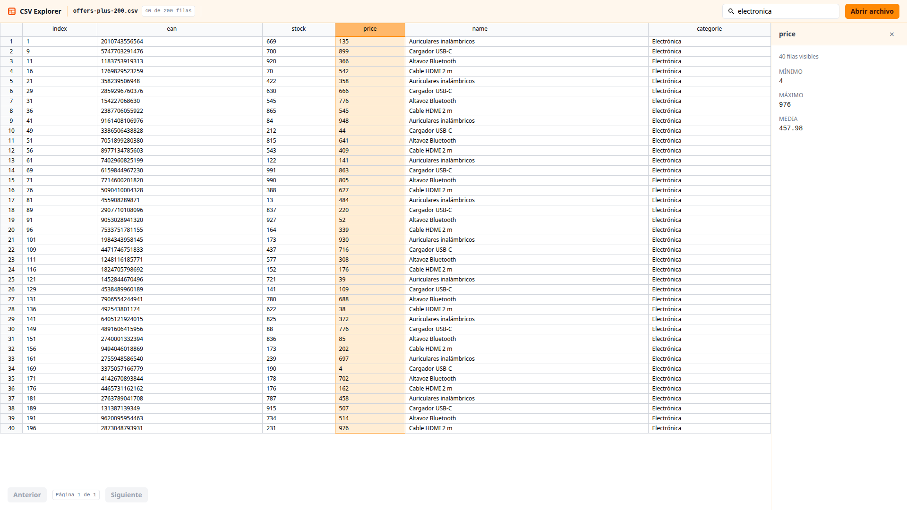

# CSV Explorer

CSV Explorer es un visor de archivos CSV para cuando solo necesitas abrir una tabla, encontrar un dato o consultar unas cifras. El archivo se procesa en tu navegador: su contenido no se envía a ningún servidor. Lo desarrollé como proyecto de portfolio y para usarlo yo mismo al trabajar con datos sensibles.

[Abrir CSV Explorer](https://minvdev.github.io/csv-explorer/)



[Pantalla inicial](screenshots/empty-state.png) · [Vista en móvil](screenshots/csv-mobile.png)

## Uso

Pulsa **Abrir archivo CSV** y selecciona un archivo con cabeceras en la primera fila. El lector detecta el separador, respeta los campos entrecomillados y admite celdas vacías. Si una fila tiene más o menos campos que cabeceras, la aplicación muestra un aviso: completa los campos que faltan con celdas vacías y omite los sobrantes.

- **Buscar:** escribe un texto para encontrar coincidencias en cualquier columna de todo el archivo, sin distinguir mayúsculas ni tildes.
- **Recorrer la tabla:** cada página muestra hasta 100 filas para evitar dibujar toda la tabla a la vez. La paginación no limita la búsqueda.
- **Consultar cifras:** selecciona la cabecera de una columna numérica para ver el mínimo, el máximo y la media. Si hay una búsqueda activa, el cálculo incluye todas las filas que coinciden, aunque estén en otras páginas. Las celdas vacías no cuentan.

Es una herramienta de consulta: no modifica el CSV original ni conserva los datos al recargar la página. El archivo se lee completo en memoria, por lo que el tamaño que se puede manejar depende del dispositivo.

[Guía de uso detallada con un CSV de ejemplo](docs/userguide.md)

## Instalación local

Necesitas Git, Node.js y pnpm. Versiones utilizadas para la validación: Node.js 24 y pnpm 12.

```sh
git clone https://github.com/minvdev/csv-explorer.git
cd csv-explorer
pnpm install
pnpm dev
```

Abre la dirección local que indique Vite en la terminal. Para comprobar el código y generar la versión de producción en `dist/`, ejecuta:

```sh
pnpm lint
pnpm format:check
pnpm test
pnpm build
```

## Desarrollo y aprendizajes

Construí la aplicación con React, TypeScript y Vite, con Papa Parse para leer los CSV y Tailwind CSS para los estilos. Una decisión que me gustó especialmente fue separar quién genera un aviso de quién lo muestra: un proveedor de React gestiona los mensajes y la barra de estado los presenta. Así, la carga de archivos y la búsqueda comparten el mismo mecanismo.

Utilicé agentes de IA con OpenCode como apoyo durante todo el proyecto. Mi experiencia previa con estructuras de datos y desarrollo web me sirvió para dirigir su trabajo, decidir qué propuestas encajaban y revisar el código generado. Las decisiones y la responsabilidad sobre el resultado son mías. Lo más difícil fue corregir casos límite sin romper comportamientos que ya funcionaban. El proyecto también me permitió reforzar mis conocimientos de React y aplicar criterios de diseño tanto en escritorio como en móvil.

## Autor

Álvaro Martínez Iniesta · [GitHub](https://github.com/minvdev) · [LinkedIn](https://www.linkedin.com/in/minvdev)

[Hoja de ruta](docs/roadmap.md) (sin planes de ampliación definidos).

## Licencia

Este proyecto está disponible bajo la [licencia MIT](LICENSE).
